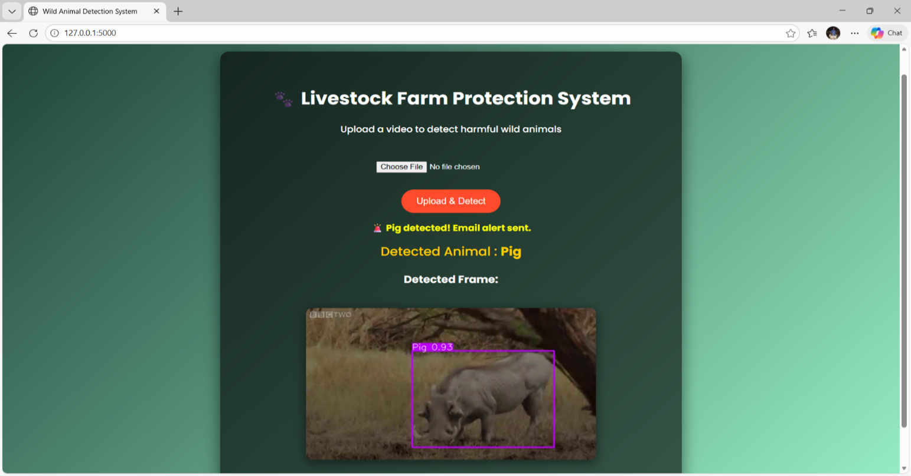
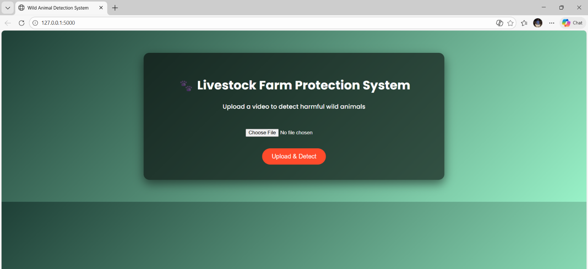
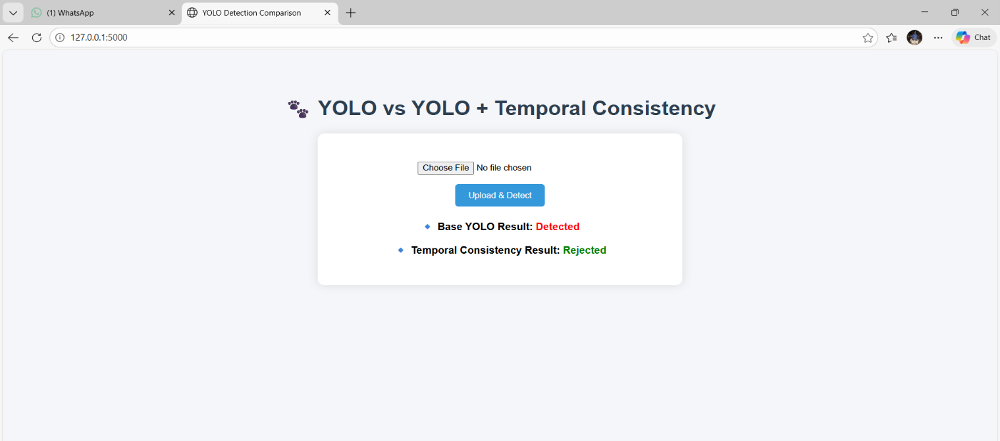

# Livestock Farm Protection from Harmful Wild Animals Using YOLOv11 with Temporal Consistency

Real-time wildlife intrusion detection for livestock farms. The system detects 13 harmful wild animal classes in surveillance video using **YOLOv11**, confirms each detection with a **temporal consistency filter** to cut false alarms, and sends an **email alert with the detected frame** as evidence.




---

## Table of Contents
- [Problem Statement](#problem-statement)
- [Key Features](#key-features)
- [Screenshots](#screenshots)
- [Results](#results)
- [How It Works](#how-it-works)
- [Dataset](#dataset)
- [Tech Stack](#tech-stack)
- [Project Structure](#project-structure)
- [Installation](#installation)
- [Usage](#usage)
- [Email Alert Setup](#email-alert-setup)
- [Limitations](#limitations)
- [Future Enhancements](#future-enhancements)
- [License](#license)

---

## Problem Statement

Farms near forests lose crops and livestock to wild animals. Manual guarding, fencing, and basic alarms are costly, need constant supervision, and often fail at night or in bad weather. Frame-by-frame object detectors also produce flickering boxes and false positives on video (moving leaves, shadows, camera noise).

This project combines a fast YOLOv11 detector with a temporal consistency check, so an alert is raised only when an animal is detected **across consecutive frames**.

## Key Features

- Detects **13 harmful wild animal classes** with YOLOv11
- **Temporal consistency filtering**: an intrusion is confirmed only after the animal appears in 5 consecutive frames
- **Automated email alerts** with the annotated frame attached as evidence
- **Flask web interface** to upload a surveillance video and view the result
- **Comparison app** (`app2.py`) that shows base YOLO and YOLO with temporal consistency side by side
- Fast inference: about **2.6 ms per image** on a Tesla T4 GPU

## Screenshots

**Main app (`app.py`):** upload a video, get the detected animal, the annotated frame, and an email alert.

| Upload page | Detection result |
|---|---|
|  |  |

**Comparison app (`app2.py`):** shows plain YOLO next to YOLO with temporal consistency. Here, base YOLO flags a detection but the temporal filter rejects it, which is how single-frame false alarms are removed.



## Results

Evaluated on the held-out test split (1,255 images, 1,375 annotated animals).

| Metric | Score |
|---|---|
| Precision | 0.9843 |
| Recall | 0.9691 |
| F1-score | 0.9766 |
| mAP@50 | 0.9934 |
| mAP@50-95 | 0.9658 |

<details>
<summary><b>Per-class test results</b></summary>

| Class | Images | Instances | Precision | Recall | mAP@50 | mAP@50-95 |
|---|---|---|---|---|---|---|
| Bear | 39 | 42 | 0.994 | 1.000 | 0.995 | 0.973 |
| Cheetah | 6 | 6 | 0.836 | 1.000 | 0.995 | 0.978 |
| Crocodile | 76 | 81 | 1.000 | 0.988 | 0.993 | 0.938 |
| Eagle | 178 | 190 | 1.000 | 0.981 | 0.995 | 0.979 |
| Elephant | 33 | 39 | 1.000 | 0.975 | 0.995 | 0.974 |
| Fox | 69 | 72 | 0.992 | 1.000 | 0.995 | 0.972 |
| Leopard | 55 | 59 | 1.000 | 0.789 | 0.995 | 0.978 |
| Lion | 99 | 103 | 0.996 | 1.000 | 0.995 | 0.979 |
| Monkey | 321 | 365 | 1.000 | 0.954 | 0.994 | 0.963 |
| Pig | 96 | 128 | 0.977 | 0.992 | 0.994 | 0.952 |
| Scorpion | 44 | 44 | 1.000 | 1.000 | 0.995 | 0.952 |
| Snake | 213 | 219 | 1.000 | 0.957 | 0.992 | 0.957 |
| Tiger | 26 | 27 | 1.000 | 0.963 | 0.981 | 0.961 |

</details>

## How It Works

```
Upload video -> Extract frames (OpenCV) -> YOLOv11 detection -> Temporal consistency filter -> Email alert + annotated frame
```

1. **Upload**: the user uploads a surveillance video through the Flask interface.
2. **Detect**: each frame is passed to the trained YOLOv11 model (confidence threshold 0.5).
3. **Confirm**: a counter tracks how many consecutive frames contain a detection. It resets to zero whenever a frame has none, so single-frame errors never trigger an alert.
4. **Alert**: once the counter reaches 5, the annotated frame is saved and emailed with the detected animal's name, and the result is shown in the interface.

| Parameter | Value |
|---|---|
| `CONF_THRESHOLD` | 0.5 |
| `CONSECUTIVE_FRAMES` | 5 |

## Dataset

- **Source:** Kaggle wildlife image dataset
- **Classes (13):** Bear, Cheetah, Crocodile, Eagle, Elephant, Fox, Leopard, Lion, Monkey, Pig, Scorpion, Snake, Tiger
- **Annotation conversion:** Pascal VOC XML converted to YOLO format (class, x_center, y_center, width, height, normalized 0 to 1)
- **Class balancing:** augmented with flipping, rotation, cropping, blur, brightness change, scaling, and noise
- **Split:** 70% train, 15% validation, 15% test. Augmentation was applied to the training set only, so evaluation reflects unseen data.

## Tech Stack

| Area | Tools |
|---|---|
| Language | Python |
| Detection model | YOLOv11 (Ultralytics, `yolo11n`) |
| Video processing | OpenCV |
| Web app | Flask |
| Numerical | NumPy |
| Alerts | SMTP (Gmail) via `smtplib` |
| Training | Google Colab, Tesla T4 GPU |

**Training setup:** `yolo11n.pt` pretrained weights, 50 epochs, image size 640, batch size 16.

## Project Structure

```
.
├── app.py              # Main Flask app: video upload, detection, temporal filter, email alert
├── app2.py             # Comparison app: base YOLO vs YOLO + temporal consistency
├── best.pt             # Trained YOLOv11 weights
├── data.yaml           # Dataset configuration (13 classes)
├── requirements.txt    # Python dependencies
├── static/             # Uploaded and detected frames, CSS
├── templates/          # HTML templates
├── screenshots/        # Images used in this README
├── LICENSE
└── README.md
```

## Installation

```bash
# 1. Clone the repository
git clone https://github.com/devanbeeda/Livestock-Farm-Protection-from-Harmful-Wild-Animals-Using-YOLOV11-With-Temporal-Consistency.git
cd Livestock-Farm-Protection-from-Harmful-Wild-Animals-Using-YOLOV11-With-Temporal-Consistency

# 2. (Optional) create a virtual environment
python -m venv venv
source venv/bin/activate        # Windows: venv\Scripts\activate

# 3. Install dependencies
pip install -r requirements.txt
```

## Usage

```bash
python app.py     # main detection app
python app2.py    # comparison: base YOLO vs YOLO + temporal consistency
```

Open `http://127.0.0.1:5000` in your browser, upload a surveillance video, and the app will process it. If a harmful animal is confirmed across 5 consecutive frames, the annotated frame is shown on the page and an email alert is sent.

## Email Alert Setup

Alerts are sent through Gmail SMTP. **Never commit your email password to the repository.** Use a Gmail [App Password](https://support.google.com/accounts/answer/185833) and set these environment variables before running the app:

```bash
export ALERT_SENDER_EMAIL="your_email@gmail.com"
export ALERT_SENDER_PASSWORD="your_app_password"
export ALERT_RECEIVER_EMAIL="farm_owner@example.com"
```

On Windows PowerShell, use `$env:ALERT_SENDER_EMAIL="..."` instead of `export`.

## Limitations

- Accuracy drops on low-resolution video and in poor visibility (heavy rain, fog, night-time).
- Very small or distant animals may be missed because of limited pixel information.
- The model recognizes only the 13 trained classes. Other species need new training data.
- Visually similar species can occasionally be confused.
- Leopard recall (0.789) is the lowest of all classes.

## Future Enhancements

- Mobile push notifications
- Multi-camera support
- Live RTSP stream input
- Cloud deployment
- Edge AI optimization for low-power devices

## License

This project is licensed under the MIT License. See the [LICENSE](LICENSE) file for details.

## Author

**Devan Beeda**
[LinkedIn](https://www.linkedin.com/in/devanbeeda/) | [GitHub](https://github.com/devanbeeda) | devanbeeda@gmail.com
